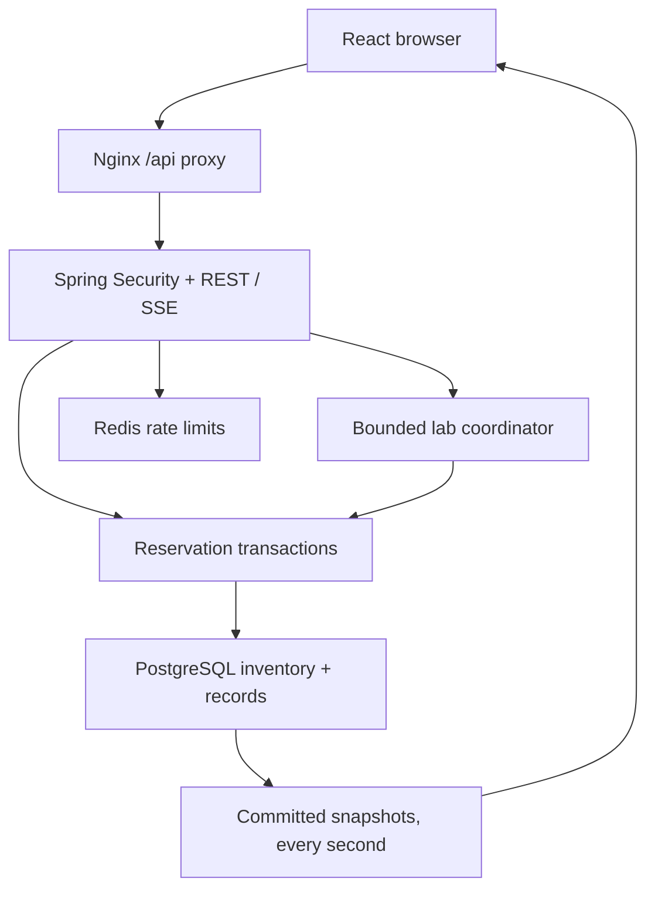
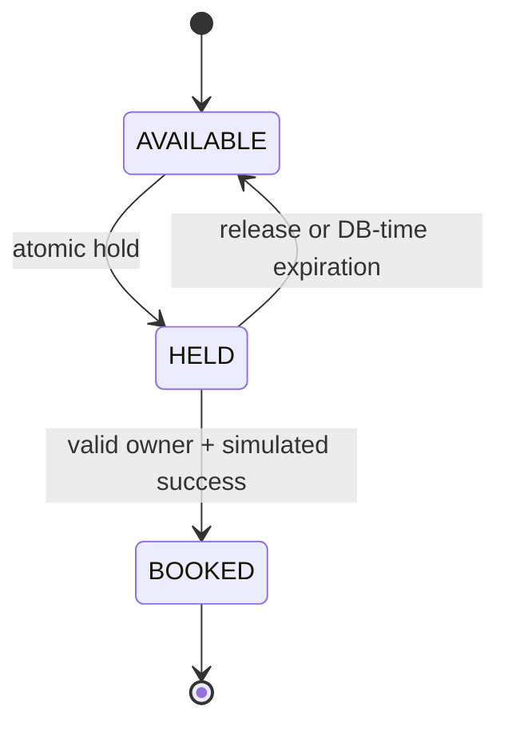

# Architecture, concurrency and schema

## State machine

Booking cancellation and hold renewal are not implemented. Availability is a *derived logical state*: a seat with a stale hold reference is available once that hold expires. No cleanup process is needed for correctness. The worker later removes stale references and marks historical holds EXPIRED.

Checkout is separate: PENDING → SUCCEEDED / DECLINED / TIMED_OUT / COMPENSATED. Payment status changes in the same transaction as the checkout status; a successful booking, its seat claims and payment effect commit together. COMPENSATED explicitly records a fictional reversal when a success callback reaches an expired/released/booked hold. There is no real payment network.

## Locking protocol

1. Lock the owning user row to bound active holds and serialize that user's mutations.
2. Lock the event row. This is a deliberate coarse lock: all inventory mutations for one event serialize. Different events/users can progress concurrently. This simplifies publication versions and bounds deadlock risk but limits hot-event throughput.
3. Lock hold/checkout rows as needed; lock seat rows in lexicographic label order for a multi-seat request.
4. Take database `clock_timestamp()` **after** locks for hold validation; validate every requested seat.
5. Write the whole transition or roll back. Bump event.version and append audit in the same transaction.

All mutation paths (including cleanup and callbacks) share the user → event lock order. No network call or simulated delay occurs with database locks held. Lock waits are capped at five seconds using the pool connection-init SQL. Transient database errors return 503 RETRY_TRANSACTION rather than looping without bound. Clients may retry a checkout with the same key; the server never silently retries a non-idempotent hold. Lab reports count transaction failures as infrastructure errors.

PostgreSQL is authoritative across JVMs. Redis only enforces per-minute login/hold/checkout rates; its loss fails those endpoints closed (503). Hold expiry and unique bookings never rely on Redis. Redis eviction/restarts may reset limits; this is a demo abuse guard, not a strict financial quota.

## Invariants and constraints

- `seat PRIMARY KEY(event_id,label)` is the single authoritative owner slot. Booking and hold cannot coexist in this row (CHECK).
- `booking_item PRIMARY KEY(event_id,label)` independently forbids duplicate booked seats. This implementation does not cancel bookings, so lifetime uniqueness is correct.
- `booking.hold_id UNIQUE` permits one booking per hold.
- `checkout UNIQUE(user_id,idem_key)` scopes idempotency. Same hold + mode replays persisted result; incompatible payload returns 409.
- `payment.checkout_id UNIQUE` ensures one fictional payment effect per attempt.
- Deterministic ordered locks + atomic validation ensure all-or-nothing multi-seat acquisition.
- Active hold ownership and expiry are checked in locked transactions. A random hold UUID is never sufficient without the authenticated owner.
- Existing expired hold-item rows are historical; they are not active inventory claims.

## Schema map

| Table | Responsibility / key |
|---|---|
| app_user | UUID identity, BCrypt password, USER/OPERATOR/ADMIN, synthetic flag |
| auth_token | SHA-256 opaque token, owner, database expiry |
| venue | Optional venue identity; demo uses event-local rectangular layouts |
| event | Event metadata, dimensions, price in cents, monotonic version, lab flag |
| seat | Unique event/label and event/coordinates; current hold or booking owner |
| hold | Owner, event, server expiration, historical lifecycle |
| hold_item | Immutable historical requested seat set |
| booking | Persisted reference, owner and unique source hold |
| booking_item | Exclusive event-seat booked claims |
| checkout | Owner-scoped idempotency, simulator mode, pending deadline, result |
| payment | One fictional effect for each checkout |
| lab_job | Bounded experiment lifecycle, cancellation flag, persisted JSON results |
| audit | Ordered activity, actor UUID, event, outcome, correlation identifier |

Migration source: `backend/src/main/resources/db/migration/V1__schema.sql`. Idempotency records are the checkout rows rather than an extra duplicate table. Publication state is event.version; no external message broker/outbox is required for the polling snapshot design.

## Availability and recovery

The SSE publisher queries committed snapshots every second, using a short event share lock so the version and seat rows correspond. It sends no user identity, token, hold UUID or booking UUID. Transaction changes are visible only after commit. This is periodic authoritative publication rather than a guarantee of instant delivery. The browser ignores lower versions, accepts repeat snapshots, shows disconnection state, reconnects, and fetches a fresh snapshot. Expiration may change logical availability without a version bump before cleanup; accepting equal versions is intentional.

The stream closes after ten minutes and reconnects. Tokens are passed in Authorization headers via fetch-stream rather than URLs. Auth tokens and holds survive restarts in PostgreSQL. Pending simulator callbacks are recovered by scheduled scans. Running load jobs cannot resume in-memory execution: a stale job is marked INCOMPLETE after two minutes, on startup or by the periodic recovery sweep; a crash during a younger job may temporarily prevent another job until that lease expires. This limitation is explicit; never interpret such a job as verified.

## Security and observability

Stateless bearer authentication, BCrypt passwords, database-backed hashed tokens, eight-hour TTL, server role checks and owner-scoped queries. No cookie-based login is used, so CSRF is disabled intentionally; browsers do not attach the bearer header automatically. sessionStorage is vulnerable to same-origin script compromise; CSP and local assets reduce exposure, but a production identity provider is recommended. Demo users are seeded only when absent.

Public inventory contains no private hold records. Operators may inspect sanitized hold lifecycle records. Management health is public only inside the Compose network; metrics and OpenAPI require authentication. The default Nginx proxy blocks actuator paths.

Micrometer: hold latency, operation/outcome counters, conflicts; actuator readiness/health and authenticated Prometheus. Audit records commit with transitions. Correlation IDs are returned in responses; audit background operations use generated IDs. No claimed internet-scale capacity: this single-event serialization strategy is an educational correctness tradeoff.
